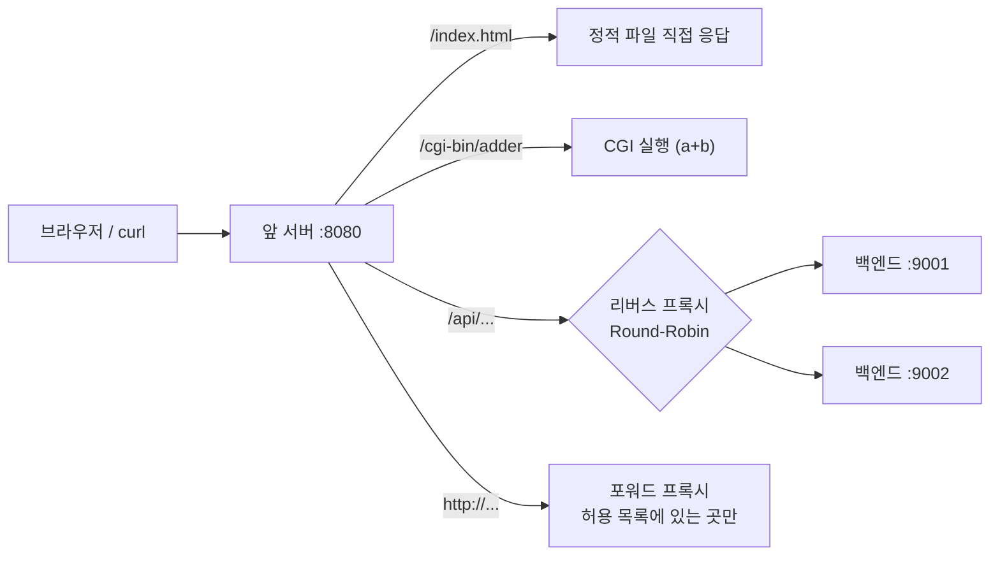
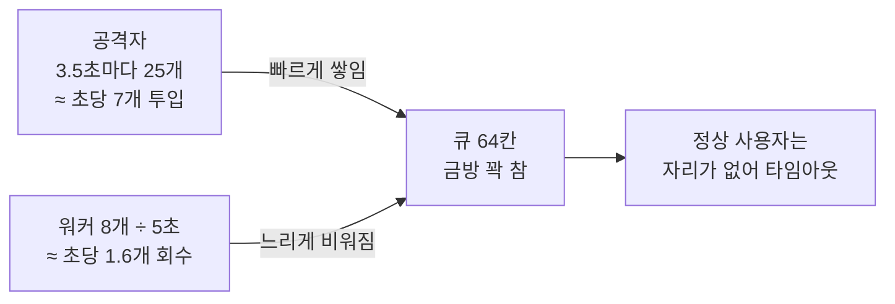

# web-server

Krafton Jungle SW-AI Lab Week13 web-server project

> **AI로 빠르게 만들 수 있다. 그런데 "통과한 테스트"가 "안전"을 보장하지는 않는다.**

외부 HTTP 라이브러리 없이 C와 POSIX 소켓 API만으로 만든 웹 서버다. 코드는 대부분 AI로 빠르게 구현했다. 그래서 이 문서는 기능 자랑보다 **AI가 만든 코드를 어떻게 믿을 수 있게 만들었는지**, 그리고 그 과정에서 무엇이 뚫렸는지에 무게를 둔다.

| 순서 | 내용 | 결과 |
| --- | --- | --- |
| ① 구현 | C·소켓으로 웹 서버 + 프록시 | 요구사항 전부 구현 |
| ② 동기 | 코드를 다 읽을 수 없으니 검증을 철저히 | — |
| ③ 테스트와 리뷰 | 단위·기능 테스트, GPT 코드 리뷰 | 리뷰가 문제 2건을 "지적" |
| ④ 블랙박스 공격 ★ | 코드를 주지 않은 AI가 실제 공격 | 2건이 실제로 뚫림 → 수정 → 재공격 |
| ⑤ 정리 | SSRF는 차단, Slowloris는 **부분적** | 검증은 한 번이 아니라 반복 |

---

## ① 구현한 웹 서버

과제 요구사항을 모두 구현했다. 프록시는 Forward와 Reverse 둘 다 만들었다.

| 요구사항 | 구현 |
| --- | --- |
| TCP 소켓 서버 | `socket` → `bind` → `listen` → `accept` |
| HTTP 요청·응답 | 요청 줄·헤더 파싱, GET·POST, keep-alive, 상태 코드 |
| 정적 파일 | HTML·CSS·JS·PNG·JPG MIME 매핑, 루트 밖 경로 차단 |
| 동적 요청 | CGI (`fork`·`execve`, GET은 환경변수, POST는 표준입력) |
| 동시 처리 | 스레드 풀 (작업 스레드 8개, 큐 64칸) |
| Reverse Proxy | 경로 규칙(`/api/*`), Round-Robin 로드밸런싱, 죽은 서버 건너뛰기 |
| Forward Proxy | 허용 목록(`호스트:포트`)에 있는 곳만 중계 |
| 종료 처리 | SIGPIPE 무시, SIGINT·SIGTERM 안전 종료 |

데모는 같은 프로그램을 포트만 바꿔 서버 3대로 띄운다. 앞 서버(8080)가 요청 주소 모양을 보고 갈라 보낸다.



**동시 처리로 스레드 풀을 고른 이유.** 스레드는 메모리를 공유해서 Round-Robin의 "다음 백엔드 번호" 같은 공용 상태를 그대로 나눌 수 있다. 연결 하나를 스레드 하나가 맡으니, 한 스레드가 CGI나 백엔드 응답을 기다려도 다른 스레드는 계속 일한다. 미리 만들어 돌려 쓰니 요청마다 만드는 비용이 없고, 개수가 정해져 있어 메모리가 안정적이다. **대신 동시에 붙잡을 수 있는 연결 수가 스레드 8개로 묶인다. 이 약점이 ④에서 문제가 된다.**

```bash
curl -i http://localhost:8080/index.html                        # → 200, text/html
curl "http://localhost:8080/cgi-bin/adder?a=3&b=4"              # CGI GET  → 7
curl -d 'a=10&b=-4' http://localhost:8080/cgi-bin/adder         # CGI POST → 6
curl "http://localhost:8080/api/adder?a=3&b=4"                  # 리버스 프록시 → 9001·9002가 번갈아 → 7
curl -x http://localhost:8080 http://127.0.0.1:9001/index.html  # 포워드 프록시 → 200
```

## ② 왜 검증에 집중했나

코드는 AI로 빠르게 만들었다. 기능을 더 붙일 수도 있었지만, 코드를 한 줄씩 다 읽고 이해할 시간은 없었고 원래 AI 코드를 그대로 믿는 편도 아니었다. 그래서 질문은 하나였다.

> **코드를 다 읽지 않고도, 이 코드를 믿을 수 있을까?**

남은 시간을 여기에 썼다. 아래는 그 답을 찾으려고 쌓은 검증 층이다.

## ③ 테스트와 코드 리뷰

먼저 테스트를 돌렸다.

| 층 | 무엇을 | 결과 |
| --- | --- | --- |
| 단위 테스트 | 파서·MIME·라우팅·스레드 풀 | 5종 통과 |
| 기능 테스트 | 서버를 띄우고 curl·nc로 실제 요청 | 114개 통과 |
| 메모리 (ASan·UBSan) | 잘못된 접근·누수·미정의 동작 | 0건 |
| 스레드 (TSan) | 데이터 경쟁 | 0건 |
| 부하 (wrk·ab) | 처리량과 오류 | 오류 0, 정적 약 12만 req/s |

통과만 보지 않고 **테스트 자체가 실패할 수 있는지**도 확인했다. 기능을 일부러 끈 빌드에서 해당 테스트가 진짜 실패하는지 본 것이다. 예를 들어 요청 전체 시간 제한을 끄면 느린 요청 테스트가, keep-alive 양보를 끄면 기아 테스트가 실제로 실패했다.

그다음 **GPT에게 코드를 리뷰하게 했다.** 리뷰는 두 가지를 짚었다.

- 포워드 프록시의 허용 검사가 **호스트 이름만 보고 포트는 안 본다** → 내부 포트로 새는 위험.
- `SO_RCVTIMEO`의 5초는 **읽기 한 번**에만 걸려서, 조금씩 보내는 느린 요청이 스레드를 계속 붙잡을 수 있다.

하지만 리뷰는 코드만 보고 한 지적이라, 아직 "그럴 수 있다"였다. 실제로 뚫리는지는 알 수 없어서 일단 기록만 했다.

## ④ 블랙박스 공격 ★

리뷰가 짚은 게 진짜인지 보려고, **소스 코드를 주지 않은 AI 에이전트 2대**에게 실행 중인 서버를 네트워크 밖에서만 공격하게 했다(블랙박스 침투 테스트). 리뷰가 짚은 두 문제가 실제로 뚫렸다.

| 취약점 | 심각도 | 무슨 일이 |
| --- | --- | --- |
| 저대역폭 DoS (Slowloris) | 높음 | 요청을 끝내지 않고 조금씩 보내는 연결 8개로 스레드 8개가 전부 묶여 서버가 먹통 |
| 포워드 프록시 SSRF | 중간 | 허용 목록이 포트를 안 봐서, 허용 호스트의 아무 포트(22·3306·6379…)로나 중계 |

### Slowloris

서버는 요청이 끝까지 와야 답한다. 그래서 요청을 끝내지 않고 아주 조금씩만 보내면 스레드 하나가 그 연결을 계속 붙잡는다. 읽기 5초 제한을 걸어 뒀지만, 공격자는 5초가 되기 전에 한 줄씩 보내 제한을 계속 피했다.

레포의 기능 테스트에 이 공격이 재현 코드로 들어 있다 ([tests/integration.sh](tests/integration.sh) 참고). 느린 연결 12개가 2초마다 헤더를 한 줄씩 흘린다.

```python
# 느린 연결 12개가 요청을 안 끝내고 2초 간격으로 헤더 한 줄씩만 보낸다
for _ in range(12):
    s = socket.create_connection((HOST, PORT))
    s.sendall(b'GET / HTTP/1.1\r\n')   # 요청을 일부러 끝내지 않는다
# 이후 2초마다 'X-a: b\r\n'을 한 줄씩 추가로 흘린다 → 읽기 타임아웃을 계속 갱신
```

### SSRF

포워드 프록시의 허용 목록이 고치기 전에는 호스트만 검사했다. 그래서 허용된 호스트의 아무 포트로나 중계됐고, 닫힌 포트는 502·열린 포트는 200이라 포트 스캐너가 됐다.

```bash
# 허용 목록: forward 127.0.0.1 localhost  ← 포트가 없다
curl -x http://localhost:8080 http://127.0.0.1:6379/   # Redis 포트로 중계됨 (뚫림)
curl -x http://localhost:8080 http://127.0.0.1:22/     # SSH 포트로 중계됨 (뚫림)
```

### 수정 → 재공격

리뷰가 제안한 대로 고쳤다. **SSRF**는 허용 목록을 `호스트:포트`로 바꿔 포트까지 검사하게, **Slowloris**는 요청 하나 전체(요청 줄+헤더+본문)에 5초 제한을 걸게 했다. 회귀 테스트도 추가했고, 수정을 끈 빌드에서 실제로 실패하는 것까지 확인했다. 그리고 **같은 AI로 같은 공격을 다시 했다.**

- **SSRF → 완전 차단.** 허용 포트(9001·9002) 외 22·3306·6379·8080 전부 403. IP를 10진·8진·16진으로 바꾸는 우회도 포트 필터를 못 뚫었다.
- **Slowloris → 부분적.** 느린 연결을 **적게**(8~12개) 유지하는 공격은 막혔다(전부 응답, 최대 ~6초 지연). 그런데 **계속 쏟아붓는** 공격에는 여전히 먹통이 됐다.

왜 부분적인가. 요청 전체 시간 제한은 연결 **하나**가 버티는 시간을 막을 뿐, 연결 **개수**는 못 막는다.



투입 속도(초당 ~7개)가 회수 속도(초당 ~1.6개)보다 빠르면 큐가 꽉 차 정상 사용자가 굶는다. 재공격에서 7사이클 내내 정상 요청이 전부 타임아웃했고, 공격 연결을 모두 닫자 즉시 회복했다. 수정은 공격 문턱을 "연결 8개"에서 "지속 고강도 폭주"로 **높였을 뿐, 없애지는 못했다.** 재공격하지 않았으면 몰랐을 사실이다.

## ⑤ 정리와 남은 한계

```text
리뷰가 찾았다   →   공격이 "진짜 뚫린다"를 보여 줬다   →   재공격이 "수정도 부족하다"를 보여 줬다
```

1. **통과한 테스트 ≠ 안전.** 테스트는 내가 상상한 조건만 확인한다. Slowloris 수정은 테스트를 통과했지만 부분적이었다.
2. **검증법 하나로는 부족하다.** 코드 리뷰는 문제를 짚었지만 심각도를 몰랐고, 블랙박스 공격은 실제로 뚫는 걸 보여 줬지만 리뷰가 찾은 다른 문제(아래)는 재현하지 못했다. 겹쳐 써야 보인다.
3. **검증은 반복이다.** 고친 뒤 같은 공격을 다시 해야 수정이 진짜인지 안다.

**남은 한계 (고치지 못했거나 리뷰만 찾은 것):**

- **Slowloris는 지금도 완전히 막히지 않는다.** 근본 해결은 IP당 동시 연결 수 제한과 이벤트 루프(epoll)다. 기존 코드를 그대로 쓸 수 있는 스레드 풀을 고른 대가다.
- **백엔드 연결에 별도 시간 제한이 없다.** `connect`가 블로킹이라, 답 없는 백엔드로 연결을 시도하면 스레드가 오래 묶일 수 있다.
- **CGI 종료가 블로킹 `waitpid`다.** 출력을 닫고도 안 죽는 CGI가 있으면 스레드가 거기서 멈춘다.
- 앞·뒤 서버가 같은 파서라 요청 밀반입이 다 막힌 것은 방어가 완벽해서가 아니라 해석 차이가 없었기 때문이다. 서로 다른 구현을 엮는 실제 환경의 desync 위험은 재현하지 못했다.

---

## 부록

발표에서 다루지 않은 세부다. 원본 전체 문서는 [docs/README_full.md](docs/README_full.md)에 있다.

<details>
<summary>빌드와 실행</summary>

검증 환경은 WSL2 Ubuntu 24.04다. 필요한 패키지는 `build-essential`, `curl`, `netcat-openbsd`, `python3`, `apache2-utils`, `wrk`다.

```bash
make                                       # 서버(./server)와 테스트용 CGI(cgi-bin/adder)
./server <port> [static_root] [cgi_dir] [route_file]
```

프록시 구성 (앞 서버 1대 + 백엔드 2대):

```bash
./server 9001 &
./server 9002 &
./server 8080 www cgi-bin routes.conf
```

```text
# routes.conf
/api/ /cgi-bin/ 127.0.0.1:9001 127.0.0.1:9002   # 리버스: <앞부분> <바꿀 앞부분> <백엔드...>
forward 127.0.0.1:9001 127.0.0.1:9002            # 포워드: 허용 호스트:포트 (포트 필수)
```

</details>

<details>
<summary>요청 처리 흐름</summary>

```text
[클라] ─연결─▶ [main 스레드] accept → 작업 큐에 넣기
                                   │
                    [작업 스레드 ×8] 큐에서 꺼내 연결 하나를 맡는다
                      ① 요청 줄·헤더 읽기, 문법·시간 검사       400 / 408 / 414
                      ② 처리 가능 여부 판단                   501 / 505 / 400
                      ③ 본문을 Content-Length만큼 읽기        400 / 408 / 413
                      ④ 갈림길 (URI 모양)
                         ├ http://...      → 포워드 프록시    403 / 501 / 502 / 504
                         ├ 규칙 앞부분     → 리버스 프록시    502 / 504
                         ├ /cgi-bin/...    → CGI              403 / 404 / 500 / 504
                         └ 그 외           → 정적 파일         403 / 404 / 405 / 500
                      ⑤ 응답 머리 + 본문 전송
                      ⑥ keep-alive면 다음 요청 대기, 아니면 닫기
```

</details>

<details>
<summary>설계 선택</summary>

| 주제 | 선택 | 이유 |
| --- | --- | --- |
| 동시 처리 | 스레드 풀 | 기존 처리 코드를 그대로 쓸 수 있고 메모리가 안정적이다. 다만 풀이 작아(8개) 느린 연결 공격에 약하다 |
| 큐가 찼을 때 | main이 자리가 날 때까지 기다림 | 요청을 버리지 않는다 |
| keep-alive 공정성 | 큐에 기다리는 연결이 있으면 스레드를 양보 | 새 클라 대기가 5,101ms → 4ms |
| 느린 요청 제한 | 요청 하나 전체에 시간 제한(5초) | 읽기 한 번 기준 제한만 있으면 한 글자씩 흘리는 연결이 워커를 무기한 붙잡는다 |
| 동적 처리 | CGI 출력을 서버가 먼저 다 받음 | `Content-Length`를 알아야 keep-alive를 유지하고, 실패하면 500으로 바꿔 답할 수 있다 |
| 프록시 | Reverse를 기본으로, Forward는 허용 `호스트:포트`만 | 아무 곳에나 중계하면 공격 통로가 된다 |
| TCP_NODELAY | 켬 | Nagle과 지연 ACK이 서로 기다려 응답이 약 40ms 늦었다 (초당 168 → 12만) |

</details>

<details>
<summary>테스트 명령과 부하 테스트 결과</summary>

```bash
make test                 # 단위 테스트 5종
bash tests/integration.sh # 기능 테스트 114개
make asan                 # ASan·UBSan 빌드로 단위·기능 테스트
bash tests/load.sh        # 부하 테스트 (wrk, ab)
```

TSan은 WSL 커널의 주소 무작위화와 충돌해서 `setarch $(uname -m) -R`을 붙여 돌렸다.

논리 코어 20개, 작업 스레드 8개. wrk는 keep-alive 연결로 10초씩, 세 번 돌린 중앙값이다. 폴더를 `/tmp`에 복사해서 쟀다(`/mnt/c`에서는 정적 파일이 초당 2천 수준으로 떨어진다).

| 시나리오 | 연결 | 초당 요청 (중앙값) | 오류 |
| --- | ---: | ---: | ---: |
| 정적 index.html (401B) | 8 | 120,020 | 0 |
| 정적 photo.jpg (786B) | 8 | 116,888 | 0 |
| CGI adder (요청마다 fork) | 8 | 4,305 | 0 |
| 리버스 프록시 → CGI adder | 8 | 5,863 | 0 |
| 리버스 프록시 → 정적 photo.jpg | 8 | 32,134 | 0 |
| 정적 index.html, 연결 > 스레드 | 100 | 57,504 | 0 |
| ab: 요청마다 새 연결, 2만 개 | 동시 100 | 36,216 | 0 |

</details>

<details>
<summary>블랙박스 테스트에서 막아낸 공격</summary>

| 공격 | 결과 |
| --- | --- |
| 경로 조작 (`../`, `%2e`, 백슬래시, null) | 403 / 404 |
| 요청 밀반입 (CL.TE, TE.CL, CL 중복, 헤더 공백·탭·줄접힘) | 400 / 501, 모호하면 `Connection: close` |
| 버퍼 넘침 (100KB URI, 200KB 헤더값, 헤더 5000개) | 414 / 400, 크래시 없음 |
| CGI 명령·포맷 주입 (`;ls`, `$(id)`, `%n`) | 인자가 argv로 처리되어 불가 |
| 메서드·버전·Host 검증 | 규칙대로 |

</details>

<details>
<summary>알려진 제한</summary>

- 느린 요청 DoS를 완전히 막지 못한다 (④ 참고).
- 백엔드 `connect`·CGI `waitpid`가 블로킹이라, 답 없는 상대에 스레드가 묶일 수 있다.
- https를 지원하지 않는다. `CONNECT`에는 501로 답한다.
- 본문은 `Content-Length` 방식만 받는다. `Transfer-Encoding: chunked`는 501.
- IPv4만 받는다.
- URL 인코딩(`%2e` 등)은 풀지 않는다. 풀지 않으니 `..` 우회에도 쓰이지 않는다.
- 정적 루트 안의 심볼릭 링크가 루트 밖을 가리키는 것은 막지 않는다 (운영자의 의도로 본다).
- 백엔드와는 요청마다 연결을 새로 연다.
- 작업 스레드 수, 큐 크기, 시간 제한(5초), 본문 상한(1MB)은 소스의 상수다.

</details>

<details>
<summary>폴더 구조</summary>

```text
src/
  main.c      인자 확인, 듣기 소켓, accept 반복, 종료 처리
  net.c       소켓 열기·접속, 끝까지 읽기·쓰기, 한 줄 읽기(시간 제한), 닫기
  pool.c      스레드 풀과 작업 큐
  conn.c      연결 하나 처리: 요청 반복(keep-alive), 갈림길
  http.c      요청 줄·헤더 파싱, 상태 코드, 응답 머리
  static.c    정적 파일: 경로 검사, MIME, 파일 전송
  cgi.c       CGI 실행과 출력 해석
  proxy.c     리버스·포워드 프록시
cgi-bin/adder.c   테스트용 CGI 프로그램 (a + b)
www/              예제 정적 파일
routes.conf       프록시 규칙 예시
tests/            단위(unit/)·기능(integration.sh)·부하(load.sh) 테스트
docs/             원본 전체 README
```

</details>
